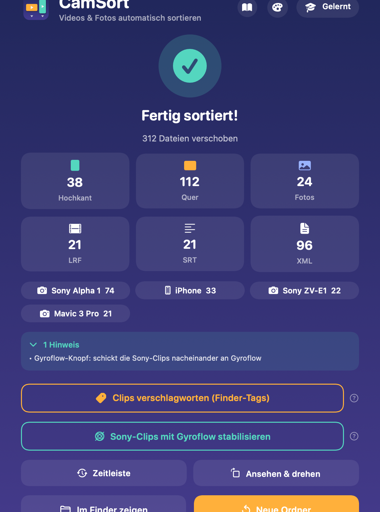

# CamSort

**CamSort sortiert Foto- und Videoordner auf dem Mac automatisch – nach Kamera, Ausrichtung und Dateityp. Auf Wunsch stabilisiert es Sony-Clips mit Gyroflow und trennt danach Stabilisiert und Original.** Dateien werden nur verschoben, nie verändert. Läuft komplett offline.



## Installation
1. Lokal bauen: `./build.sh` (Xcode bzw. Command Line Tools nötig) → `build/CamSort.app` (Universal) und `build/CamSort.zip`. **CamSort** in den Programme-Ordner ziehen. Ältere Versionen gibt es unter **Releases**.
2. Einmalig im Terminal (die App ist nicht bei Apple registriert):
   ```
   xattr -dr com.apple.quarantine /Applications/CamSort.app
   ```
3. Benötigt macOS 14 (Sonoma) oder neuer. Läuft auf Apple Silicon und Intel.

> Zum Weitergeben immer die **ZIP-Datei** schicken, nicht die App selbst – sonst geht sie beim Übertragen kaputt.

## Funktionen

| Funktion | Was passiert |
|---|---|
| **Sortieren** | Ordner ins Fenster ziehen → *Sortieren starten*. Videos landen in `Videos/<Kamera>/Hochkant` bzw. `Quer`. |
| **Aktualisieren** | Bei bereits sortierten Ordnern: nur neue Dateien werden einsortiert, Bestehendes bleibt unberührt. |
| **Dateitypen** | Eigene Ordner für `Fotos`, `Musik`, `ZIP`, `FCP` (Final-Cut-Mediatheken/FCPXML) sowie `XML`, `LRF`, `SRT`. Unbekannte Typen fragt CamSort einmal ab und merkt sie sich. |
| **Kameras** | Erkennt Sony (inkl. Modell, z. B. Alpha 1 / ZV-E1), DJI, iPhone, Samsung, Insta360, Canon, GoPro, Pixel u. a. Neue Kameras werden einmal abgefragt und gemerkt. *Gelernt* (oben rechts) zeigt alles Gelernte. |
| **Schnell durch** | Bei Rückfragen: *Nicht mehr fragen – Rest nach bestem Wissen sortieren*. |
| **Duplikate** | Überspringen, beide behalten (`(2)` im Namen) oder ersetzen (alte Datei → Papierkorb) – auch „für alle“. |
| **Unterordner** | Optional werden auch Unterordner durchsucht; jede Datei wird dort einsortiert, wo sie liegt. |
| **Nach Objektiv** | Optional: `Videos/<Kamera>/<Objektiv>/Hochkant|Quer` (zuverlässig bei Sony). |
| **Drohne nach Geschwindigkeit** | Optional: Ø-Geschwindigkeit aus der SRT → `Stand`, `Fahrt`, `Dazwischen` oder `Ohne GPS`. Bereiche per Regler. |
| **Gyroflow stabilisieren** | Nach dem Sortieren: *Sony-Clips mit Gyroflow stabilisieren*. Einzeln nacheinander, erst Hochkant, dann Quer, mit **Pause**. Nutzt dein Gyroflow-Preset – keine Codec-Rückfragen. Danach automatisch `Stabilisiert` / `Original` / `Gyroflow-Projekte`. Der Knopf lässt sich in den Einstellungen mit einem Schalter ausblenden. |
| **Nur Gyroflow trennen** | Wer selbst in Gyroflow rendert: *Nur Gyroflow-Clips trennen*. Erkennt stabilisierte Dateien an Endungen wie `_gyro`, `_stabilized`, `_gyroflow` (einstellbar). |
| **Hilfe** | Jede Einstellung hat ein **?**; das Buch-Symbol oben rechts öffnet die komplette Anleitung. |
| **Farben** | Palette oben rechts: Farbschema oder eigene Hintergrundfarben. |

Alle Einstellungen und alles Gelernte bleiben nach einem Neustart erhalten.

**Einstellungen in jeder Phase:** Zahnrad oben rechts im Kopf (⌘,) – auch beim Sortieren, im Fertig-Bildschirm, nach Gyroflow und nach Abbruch. Läuft gerade ein Lauf, zeigt das Fenster „Änderungen gelten ab dem nächsten Lauf“: Ein Lauf arbeitet mit einer Momentaufnahme der Einstellungen vom Start.

## Videos-Sammelordner (abschaltbar)
*Einstellungen › Sortieren › Videos-Sammelordner anlegen* (Standard: an = bisheriges Verhalten `Dreh/Videos/…`).
- **Aus:** Die Ebenen liegen direkt im Dreh: `Pitbike/Sony ZV-E1/Hochkant`, mit Objektiv `Pitbike/Sony ZV-E1/FE 24-70/Quer`. Fotos, Begleitdateien und Extras bleiben in ihren eigenen Ordnern.
- Erneutes Einlesen erkennt die Ebenen-Ordner an Ausrichtung, Framerate bzw. Szene (auch zusammengesetzt wie `Sony · Quer`) – der zweite Lauf verschiebt nichts. Ist keine dieser Ebenen aktiv, legt CamSort den Videos-Ordner trotzdem an (sonst wäre Sortiertes nicht erkennbar).
- Gyroflow, Auswahl (Selects), Verschlagworten und Timeline finden die Clips auch ohne Videos-Ordner.
- Im Modus „Meine Kameraordner“ entsteht nie ein Videos-Ordner (`E1/Hochkant`).
- **Kameraordner sind kein Dreh:** Liegen im eingeworfenen Ordner eigene Kameraordner nebeneinander (`Pitbike/E1`, `A1`, `Avata` mit losen Clips oder Kartenstruktur), ist der Dreh `Pitbike` – nicht mehr `E1/Videos`. Lose Kartendateien (z. B. `SONYCARD.IND`) neben `PRIVATE`/`DCIM` stören die Erkennung nicht mehr. Ist „Meine Kameraordner“ aus, schlägt CamSort einmal vor, den Modus zu verwenden (`E1/Hochkant`, `E1/Quer`, mit *Antwort merken*).

## Neu ordnen bei geänderten Einstellungen
Jeder kompakt sortierte Dreh bekommt eine unsichtbare Datei `.camsort-layout` (welche Einstellungen die Struktur bestimmt haben: Videos-Ordner, Ebenen, Reihenfolge, verschachtelt, Trennzeichen). Wird ein sortierter Ordner mit anderen Einstellungen erneut eingeworfen, fragt CamSort: „Dieser Ordner wurde mit anderen Einstellungen sortiert. Jetzt neu ordnen?“ – mit 1–2 Beispielpfaden Alt → Neu.
- **Neu ordnen:** alle einsortierten Clips (inkl. `Stabilisiert`/`Original`, Gyroflow-Projekte wandern mit) werden in die neue Struktur verschoben – nur verschieben, nie überschreiben (Duplikat-Rückfrage wie immer). Die Kamera kommt aus dem bisherigen Ordner, es wird nicht neu gefragt. Leer gewordene Ebenen-Ordner werden entfernt. Final-Cut-Mediatheken im Dreh werden danach zum Neu-Verknüpfen angezeigt.
- **So lassen:** bisherige Struktur bleibt, nur neue Dateien werden einsortiert; für genau diese Einstellungen wird nicht erneut gefragt.
- Drehs ohne `.camsort-layout` (ältere Läufe): CamSort leitet die Struktur aus den Ordnernamen ab; passt sie schon, wird nur die Datei geschrieben, sonst kommt die Frage „Mit aktuellen Einstellungen neu ordnen?“.
- Nicht automatisch umgebaut wird zwischen kompaktem Modus und „Meine Kameraordner“ in Richtung Kameraordner.

## Modus „Meine Kameraordner“
Für alle, die beim Heimkommen selbst einen Ordner pro Kamera anlegen (z. B. `A1`, `Mini-Drohne`, `Avata`, `ETC`) und die Karten hineinkopieren. Einschalten: *Einstellungen › Sortieren › Meine Kameraordner* oder direkt per Schalter im Startbildschirm. Standard: aus.

- **Dreh-Ordner wählen** (enthält die Kameraordner) → jeder direkte Unterordner ist eine Kamera. **Kameraordner direkt wählen** (enthält selbst Videos oder `PRIVATE`/`DCIM`) → er selbst ist die Kamera. Mehrere Ordner gleichzeitig gehen auch.
- CamSort erkennt, fragt und benennt **keine** Kamera. In jedem Kameraordner landen Videos – auch aus `PRIVATE/M4ROOT/CLIP`, `DCIM/100MEDIA`, `DCIM/DJI_001` oder verschachtelten Kartenkopien – in `Hochkant`, `Quer` oder `Quadratisch`.
- Begleitdateien (XML, SRT, LRF, THM …) → `<Kamera>/Begleitdateien`, Fotos → `<Kamera>/Fotos`, Musik/ZIP/FCP → `<Kamera>/Extras/…`. Leer gewordene Kartenordner werden entfernt – aber nur, wenn wirklich nichts mehr drin ist. Sony-Proxys (`M4ROOT/SUB`) und `THMBNL` bleiben unangetastet.
- **Lose Dateien** direkt im Dreh-Ordner bleiben liegen und werden gemeldet. 0-Byte- oder kaputte Clips bleiben liegen und werden gemeldet. Aliasse/Symlinks werden übersprungen.
- **Mehrfach einlesen ist sicher:** `Hochkant`/`Quer`/`Quadratisch`, `Begleitdateien`, `Fotos`, `Extras` und *Eigene Ordner* werden nicht neu sortiert. Neue Kameraordner oder nachgelegte Clips werden einsortiert; das Ergebnis zeigt z. B. *„Neu sortiert: E1 (12 Clips) – unverändert: A1, Mini-Drohne“*. Vorhandene Ordner wie `hochkant` werden wiederverwendet.
- Zusätzliche Baukasten-Ebenen (Objektiv, Länge, Drohne Stand/Fahrt, Aufnahmetag) gelten **unter** dem Kameraordner: `A1/Hauptspur/Quer`. Szene und Kamera entfallen in diesem Modus (der Ordner ist die Kamera).
- Ordner wie `Export` werden als Kamera behandelt, CamSort weist darauf hin – unter *Eigene Ordner* eintragen, dann bleiben sie unberührt.

## Ausrichtung
Seitenverhältnis nach Drehung: **0,9–1,1 → `Quadratisch`** (z. B. DJI Osmo Action 6 mit 3840×3840 – daraus lassen sich Hochkant und Quer schneiden), sonst breiter = `Quer` (auch 4:3), höher = `Hochkant` (auch 3:4). Der Name `Quadratisch` ist unter *Ordner & Namen* änderbar.

## Datensicherheit

Oberstes Ziel: Durch CamSort geht keine Datei verloren.

**Erst alle Fragen, dann verschieben.** Ein Lauf hat zwei Phasen. In Phase 1 stellt CamSort sämtliche Rückfragen über alle eingeworfenen Ordner hinweg – Speicherkarte, Kameraordner-Vorschlag, Projekte (inkl. Namen), unbekannte Dateitypen, Kameras, Neu ordnen, Tagesordner, Framerate – und berechnet alle Ziele. Erst danach (Phase 2) wird verschoben. Abbrechen in irgendeiner Frage heißt: keine Datei bewegt, kein Ordner angelegt. Jede Frage zeigt ein echtes Beispiel aus genau diesem Ordner (z. B. `C0042.MP4 → Pitbike/E1/50 fps/Hochkant`) und hebt eine Empfehlung mit kurzem Grund hervor (nie automatisch übernommen). Mit **Zurück** geht es zur vorigen Frage (Antwort vorbelegt, Folgefragen werden neu berechnet). „Antwort merken“ wird erst beim Start dauerhaft gespeichert.

**Übersicht vor dem Start.** Zum Schluss der Fragenrunde: „X Dateien werden verschoben, Y Ordner angelegt – nichts wird verändert oder gelöscht“ mit einer Vorschau der neuen Ordnerstruktur (obere Ebenen + Anzahl Dateien). Abschaltbar unter Einstellungen › Datensicherheit bzw. per „Übersicht nicht mehr anzeigen“.

Ausnahmen (bewusst): Die Frage „Datum in den Ordnernamen?“ kommt nach dem Sortieren (betrifft nur den Ordnernamen). Duplikat-Rückfragen entstehen erst beim Verschieben; „Überspringen“ ist Standard und lässt beide Dateien unangetastet. Wird ein Ordner in Projekte getrennt, sortiert CamSort danach in den Projektordnern – Fragen zu Neu ordnen/Tagesordnern/Framerate kommen dann nach dem Anlegen der Projekte; wer dort abbricht, bekommt die Projekt-Trennung automatisch rückgängig gemacht.

**Sicheres Verschieben.** CamSort verschiebt nur innerhalb desselben Laufwerks (atomares Umbenennen, nie Kopieren + Löschen). Liegt ein Ziel auf einem anderen Laufwerk, wird nicht verschoben, sondern gemeldet. Nach jedem Verschieben wird geprüft: Ziel vorhanden, Größe gleich, Quelle weg – sonst stoppt der Lauf sofort. Gelöscht werden ausschließlich leere Ordner (höchstens `.DS_Store` darin), nie eine Datei. „Ersetzen“ bei Duplikaten legt die alte Datei in den Papierkorb (protokolliert, zurückholbar).

**Speicherkarten-Schutz.** Liegt ein eingeworfener Ordner auf einer Speicherkarte bzw. einem Wechseldatenträger (oder hat das Laufwerk DCIM/PRIVATE an der Wurzel), fragt CamSort: „Zum Import“ (empfohlen) / „Trotzdem hier sortieren“ / „Abbrechen“. Der Import kopiert, prüft jede Kopie per SHA-256, verwirft eine fehlerhafte Kopie, überschreibt im Ziel nie (gleicher Name, andere Größe → gemeldet, nicht kopiert) und verändert die Karte nie.

**Bewegungsprotokoll.** Jeder Schritt (Verschieben, Ordner anlegen, Umbenennen, leeren Ordner löschen, Papierkorb, Markierungsdatei, Drehen, Gyroflow-Trennen, Neu ordnen, Projekt-Trennen) wird vor der Ausführung als „geplant“ und danach als „erledigt“ in ein Protokoll geschrieben – eine JSON-Zeile pro Schritt (Art, Quelle, Ziel, Größe, Zeit), sofort mit fsync auf die Platte. Auch nach Absturz oder Stromausfall ist damit nachvollziehbar, was passiert ist. Zwei Kopien:

- `~/Library/Application Support/CamSort/Protokolle/<Datum Uhrzeit>.json` (absolute Pfade)
- unsichtbar im eingeworfenen Ordner: `.camsort-protokoll/<Datum Uhrzeit>.json` – Pfade relativ zum Ordner, funktioniert also auch nach Umbenennen, Verschieben auf eine andere Platte oder an einem anderen Mac.

**Rückgängig.** Im Fertig-Bildschirm „Rückgängig machen“; unter Einstellungen › Datensicherheit › Letzte Läufe jeder Lauf (auch nach Neustart); und Wochen später direkt im Startbildschirm: Ordner erneut einwerfen → „Sortiert am 09.11.2026 · 120 Dateien – Rückgängig machen“. Vorher kommt eine Bestätigung („X Dateien gehen zurück an ihren ursprünglichen Platz“). Rückgängig läuft in umgekehrter Reihenfolge, legt Dateien nur zurück, wenn sie noch am Ziel liegen (gleiche Größe) und der Ursprung frei ist – nie überschreiben; alles andere wird übersprungen und am Ende aufgelistet. Umbenannte Ordner bekommen ihren alten Namen zurück, von CamSort angelegte Ordner werden entfernt, sofern sie leer sind, Drehungen werden über die protokollierten 36 Byte zurückgesetzt. Mehrere Läufe nur vom jüngsten an. Das Protokoll wird danach als „rückgängig gemacht“ markiert, nicht gelöscht. Final-Cut-Mediatheken werden zum Neu-Verknüpfen angezeigt.

Grenzen: Finder-Tags, die CamSort vergeben hat, bleiben. Was nach dem Lauf von Hand verändert, umbenannt oder gelöscht wurde, bleibt, wie es ist. Ein beim Absturz gerade in den Papierkorb gelegtes Duplikat kann CamSort nicht finden (Hinweis: im Papierkorb nachsehen).

## Rückfragen vor dem Sortieren
CamSort fragt nur, wenn es für den Ordner wirklich relevant ist – jede Frage mit *Antwort merken* (änderbar in den Einstellungen):
- **Mehrere Aufnahmetage?** → *Tagesordner oben* (`Dreh/2026-10-12/A1/Hochkant`), *unter der Kamera* (`Dreh/A1/2026-10-12/Hochkant`) oder *Nein*. Datum aus den Video-Metadaten, Format einstellbar (Standard `JJJJ-MM-TT`), optional zählen Aufnahmen bis 4 Uhr zum Vortag. Gibt es schon Tagesordner, wird die Struktur ohne Frage weitergeführt. Auch als Baukasten-Ebene *Aufnahmetag*.
- **Datum in den Ordnernamen?** (nach erfolgreichem Sortieren, nur wenn noch kein Datum im Namen steht): `Pitbike` → `2026-10-12 Pitbike` bzw. `2026-10-12–15 Pitbike`, vorne oder hinten. Nur der Ordner wird umbenannt. Gibt es den Namen schon, ist es eine Karte/Volume-Wurzel oder ein direkt gewählter Kameraordner, bleibt der Name.

## Projekte trennen (lange Drehpause)
Liegt zwischen den Clips (alle Kameras gemeinsam, Zeitintervalle Start–Ende gemergt) eine **auffällig lange Pause**, schlägt CamSort als erste Rückfrage vor, die Dateien in mehrere Projekte zu trennen – z. B. „Zwischen 11:58 und 15:04 liegt eine Pause von 3 Std. 6 Min.“ mit Übersicht je Projekt (Zeitraum, Clips je Kamera). Auffällig = mindestens die Mindestpause (Einstellung, Standard 90 Min., 30 Min.–12 Std.) **und** bei mind. 4 Lücken mindestens 4× der Median-Pause des Drehs. Kurze Pausen (10–20 Min.) lösen nie eine Frage aus; über Mitternacht ohne lange Pause bleibt es ein Projekt.

- **Ja, getrennt ablegen**: Namensfelder je Projekt, vorbelegt mit Datum + Tageszeit (`2026-11-08 Vormittag`). Ablage als Unterordner **im** eingeworfenen Ordner (`Pitbike/2026-11-08 Nachmittag/Videos/…`, Modus Kameraordner: `Pitbike/<Projekt>/A1/Hochkant`); die relative Lage (Kameraordner, Kartenstruktur) bleibt erhalten, leer gewordene Ordner werden entfernt. Gibt es den Ordner schon, wird er weiterverwendet.
- Fotos → Projekt ihres Aufnahmedatums (EXIF), Begleitdateien folgen ihrem Clip, Dateien ohne Datum → erstes Projekt (Hinweis).
- **Falsche Kamerauhr**: Liegt eine Kamera ganz allein in einem Zeitblock, zeigt die Frage einen Hinweis und die Option, sie dem Projekt mit den meisten Clips zuzuordnen.
- Datum: Tagesordner-Frage nur, wenn innerhalb eines Projekts mehrere Tage vorkommen. Steht im Projektnamen ein Datum, entfällt das Umbenennen; der Elternordner wird nicht umbenannt.
- Erneutes Einlesen: Projektordner tragen eine unsichtbare Datei `.camsort-projekt` (Name, Zeitraum). Neue Clips, die zeitlich passen, landen ohne Frage im Projekt; sonst wird erneut gefragt. Bereits sortierte Drehs ohne Projektordner werden nicht umgebaut.
- Einstellung: Fragen / Immer trennen (fragt trotzdem bei Verdacht auf falsche Kamerauhr) / Nie. „Antwort merken“ setzt Immer bzw. Nie.

## Framerate (FPS)
Optionale Ebene *Framerate (FPS)* im Ordner-Baukasten (kompakt und „Meine Kameraordner“, z. B. `Dreh/A1/50 fps/Hochkant`).
- **Rückfrage:** Nur wenn die neuen Clips mindestens zwei Frameraten haben: „Auch nach Framerate sortieren?“ (*Ja, unter der Kamera* / *Nein*, „Antwort merken“). *Ja* ohne Merken gilt nur für diesen Lauf; gemerktes *Ja* aktiviert die Ebene dauerhaft, gemerktes *Nein* stellt die Frage auf *Nie* (Einstellungen › Nach Framerate fragen). Gibt es schon FPS-Ordner, wird die Struktur ohne Frage weitergeführt.
- **Klassen (enge Toleranz ±0,3, nie ±1):** 23,976/24 → 24 · 25 · 29,97/30 → 30 · 47,952/48 → 48 · 50 · 59,94/60 → 60 · 100 · 119,88/120 → 120 · 200 · 239,76/240 → 240; sonst nächste ganze Zahl. 24 fällt nie mit 25, 48 nie mit 50, 120 nie mit 100 zusammen.
- **Sony-Zeitlupe (S&Q):** Die Datei hat z. B. 25p, aufgenommen wurde mit 100p. CamSort liest die Aufnahme-Framerate `captureFps` aus `<VideoFrame captureFps="100p" formatFps="25p">` im Sony-NRT-XML (Begleit-XML `…M01.XML` oder eingebettet) → Ordner „100 fps“.
- **Variable Framerate:** Meldet die Videospur keine plausible Framerate (0), landet der Clip in „Variable fps“. iPhone-Clips mit variabler Framerate melden meist ihren Mittelwert (≈ 30) und kommen in dessen Klasse; iPhone-Slo-Mo wird nicht gesondert ausgewertet.
- **Ordnername:** Schablone unter *Ordnernamen › Framerate*, Standard `{n} fps`. FPS-Ordner werden beim erneuten Einlesen erkannt (nie als Kamera, auch nicht in der Zeitleiste).
- Framerate wird im selben Ladevorgang wie die Bildgröße gelesen (`track.load(.naturalSize, .preferredTransform, .nominalFrameRate)`).

## Gyrodaten erkennen
Nach dem Sortieren prüft CamSort jeden Clip auf Bewegungsdaten, die Gyroflow lesen kann (Erkennung wie Gyroflows *telemetry-parser*): Sony (XML), DJI mit eingebetteten Gyrodaten (`djmd` + `DJI meta`, z. B. Avata/Osmo Action), GoPro (GPMF), Insta360. Schon stabilisierte Clips sind nicht dabei. Der Fertig-Bildschirm bietet dann an: *„X Clips enthalten Gyrodaten (A1: 10, Avata: 4) – jetzt stabilisieren?“*.

### Ausgabe wie Eingabeclip (Standard)
Aus deinem Preset übernimmt CamSort **nur Glättung und dynamisches Zoomen**. Objektivprofil, Auflösung, Format, Framerate, Codec und Ton richten sich nach jedem Clip – ein Preset passt so für alle Kameras in einem Lauf.

- CamSort schreibt dafür eine reduzierte Kopie `~/Library/Application Support/CamSort/Gyroflow-Presets/.camsort-nur-stabilisierung.gyroflow` (Whitelist aus `stabilization`: `method`, `smoothing_params`, Horizont-Ausgleich, `fov`, `adaptive_zoom_window`, `adaptive_zoom_center_offset`, `adaptive_zoom_method`, `max_zoom`, `max_zoom_iterations`, `fixed_zoom`, `zoom_limit_whole_clip`). Dein Preset bleibt unverändert. Ist es unlesbar, nutzt CamSort es komplett und meldet das.
- Ohne `calibration_data` wählt Gyroflow das Objektivprofil pro Clip selbst aus den Metadaten (Sony, DJI, GoPro, Insta360).
- Pro Clip gehen an die Gyroflow-CLI: `-p {"output_width":…,"output_height":…,"codec":…,"codec_options":…,"bitrate":…,"audio":true,"audio_codec":"Copy"}` – kodierte Quellgröße (16:9, 9:16, 4:3, 1:1), H.264→H.264, HEVC→H.265, ProRes→ProRes (gleiches Profil), sonst H.265; Bitrate ≈ Quelle (mind. 10 Mbit/s); Ton wird kopiert (sonst AAC; Clips ohne Ton gehen trotzdem).
- Framerate: Gyroflow rendert immer mit der Quell-Framerate; `video_speed` wird bewusst nicht übernommen.

Aus: Preset komplett wie früher. Einstellbar unter *Einstellungen › Gyroflow*.

## Final-Cut-Mediathek aus dem Ordner

Nach dem Sortieren legt CamSort auf Wunsch aus jedem Dreh- bzw. Projektordner eine **gleichnamige Final-Cut-Mediathek** an (`Pitbike/Pitbike.fcpbundle`):

- CamSort schreibt `Pitbike.fcpxml` (FCPXML 1.10) in den Ordner und öffnet sie in Final Cut. Die Importoption `library location` sorgt dafür, dass Final Cut die Mediathek genau dort neu anlegt (bzw. öffnet, wenn es sie schon gibt); `copy assets = 0` verknüpft die Medien nur – **nichts wird kopiert oder verändert**.
- Ein Ereignis mit dem Ordnernamen, darin alle Clips (stabilisierte Fassung mit Schlagwort „Stabilisiert“, Original zusätzlich mit „Original“ – abschaltbar), Fotos (abschaltbar, Schlagwort „Foto“) und Musik/Soundeffekte (Rolle Musik bzw. Effekte).
- **Schlagwörter aus der Ordnerstruktur:** Kamera, Objektiv, Hochkant/Quer/Quadratisch, Framerate („50 fps“), Länge, Szene, eigene Ordner – plus vorhandene Finder-Tags. In Final Cut erscheinen sie links als Schlagwortsammlungen.
- Gibt es die Mediathek schon, kommen nur neue Clips als Ereignis „Pitbike – Nachtrag <Datum>“ dazu. Welche Dateien schon drin sind, steht in der unsichtbaren Datei `.camsort-fcp.json`.
- Einstellungen › Final Cut: „Nach dem Sortieren Mediathek anlegen“ (Fragen / Immer / Nie), „Fotos aufnehmen“, „Originale neben stabilisierten aufnehmen“. Läuft Gyroflow noch, wird die Mediathek danach angelegt.
- Die `.fcpxml`, die Mediathek und `.camsort-fcp.json` bleiben beim erneuten Sortieren liegen und werden beim Rückgängigmachen nicht gelöscht. Nach „Neu ordnen“/Rückgängig zeigt CamSort den Hinweis zum Neu-Verknüpfen auch für diese Mediathek.
- Ohne Final Cut: Die FCPXML liegt bereit – in Final Cut über *Ablage › Importieren › XML …* öffnen.

## Gyroflow-Preset einrichten (einmalig)
1. Gyroflow öffnen, einen Sony-Clip hineinziehen, Einstellungen wie gewohnt.
2. Kleiner Pfeil am Knopf **Export** → **Create settings preset**.
3. Alle Haken setzen – besonders bei Export/Codec.
4. Als z. B. `Sony.gyroflow` in *Dokumente* speichern.
5. In CamSort: *Einstellungen › Gyroflow › Preset-Datei wählen …*

Hinweis: Die App-Store-Version von Gyroflow lässt sich evtl. nicht fernsteuern. Dann meldet CamSort das – Abhilfe ist die kostenlose Version von [gyroflow.xyz](https://gyroflow.xyz).

## Ergebnis-Struktur
```
Dein Ordner/
├── Videos/
│   └── Sony Alpha 1/
│       ├── Hochkant/
│       └── Quer/
│           ├── Stabilisiert/
│           ├── Original/
│           └── Gyroflow-Projekte/
├── Fotos/   Musik/   ZIP/   FCP/
└── XML/     LRF/     SRT/
```
